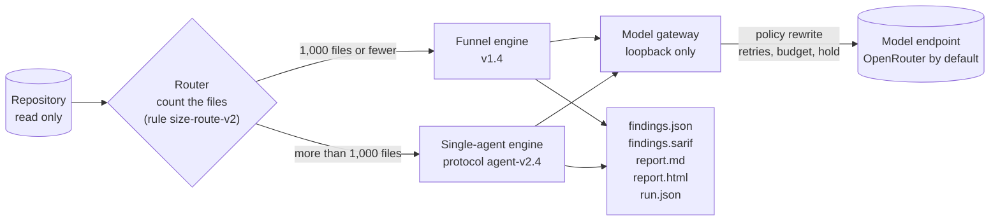
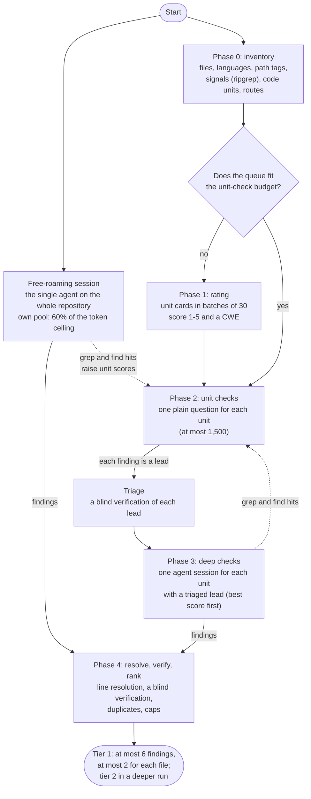
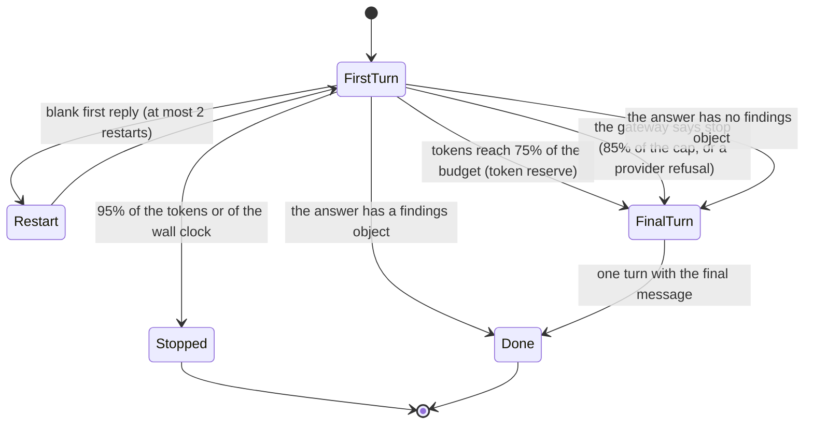
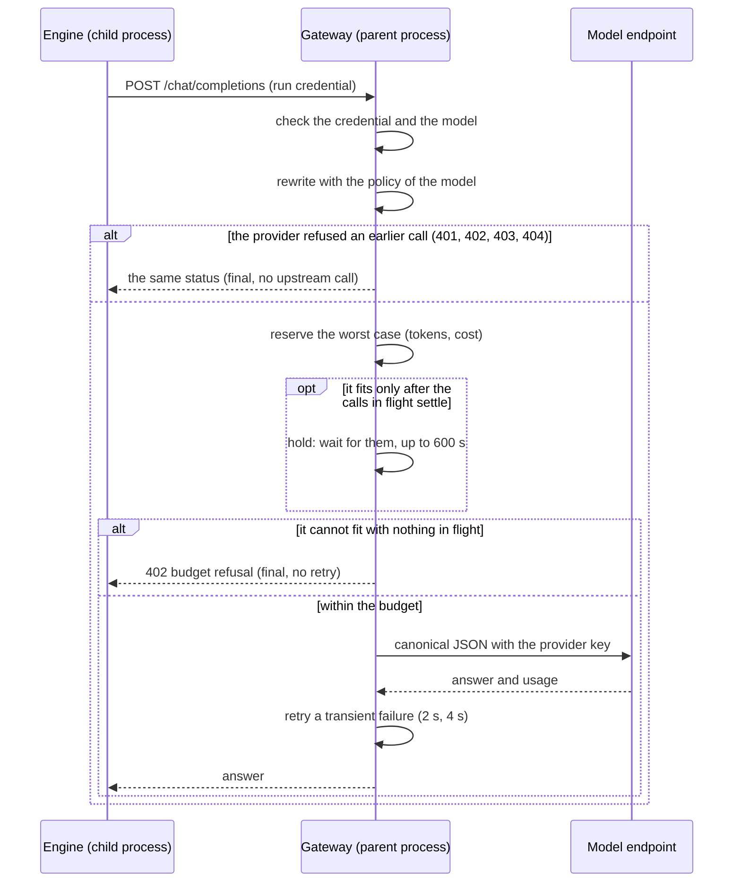
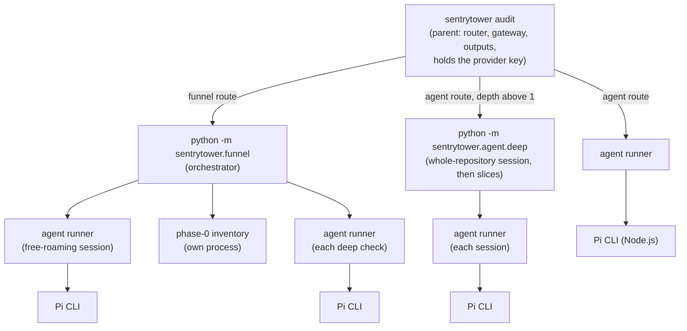

# Architecture

SentryTower is a size-routed hybrid of two engines behind one model gateway.
This page describes the router, the two engines, the gateway, the money
rules, the result of a run and the process model. The defaults are the
measured values.

## Overview

1. The **router** counts the regular files of the repository once, before
   any model call ([the router](#the-router)). With 1,000 files or fewer,
   the run uses the funnel engine; with more, the single-agent engine. The
   threshold was fixed before the benchmark and not tuned.
2. The **engine** of the route runs as a child process.
3. Each model call of the engine goes through the **model gateway**, a
   local endpoint of the parent process.
4. The parent reads the output of the engine, decides the **result** of the
   run and writes the **outputs**.

## The router

The router counts the regular files of the repository with the rule
`size-route-v2`. It does not follow links, and it stops at 1,001. The count
leaves out each folder that holds no code of the project, at any depth below
the root (the root always counts):

- installed dependencies and caches: `node_modules`, `bower_components`,
  `jspm_packages`, `.venv`, `site-packages`, `__pycache__`, `.tox`,
  `.gradle`, `.next` and similar;
- vendored, generated and build folders: `vendor`, `third_party`, `dist`,
  `build`, `target`, `out`, `coverage` and similar. A build folder below a
  source folder (`src`, `lib`, `app`, `packages` and similar) counts as
  source code, unless a build file such as `package.json`, `pom.xml` or
  `Cargo.toml` is next to it, as in `app/build` of an Android app or
  `packages/ui/dist` of a monorepo;
- version-control folders: `.git`, `.hg`, `.svn`, `.bzr`, `_darcs`, `CVS`,
  `.jj`, `.pijul` and `.sl`;
- Python virtual environments: `venv`, and each folder with a `pyvenv.cfg`
  file.

The threshold stays 1,000 files, and the large-repository rule of the
funnel uses the same count. `run.json` records the rule and the skipped
folders (`router.skipped`: the folders, their files and at most 50 names).

## Why two engines

The funnel follows one design idea: the orchestrator selects the code to
read, divides the budget and decides when to stop, and the agent sessions
get narrow tasks. A free agent can choose badly what to read in a
repository, and it can stop early.

On a small repository the funnel can check each code unit. On a large
repository its unit checks cover a smaller part of the code within the
budget. The router therefore sends a repository of more than 1,000 files to
the single agent. The threshold is the large-repository rule of the funnel;
it was fixed before the benchmark and not tuned.

In the confirmation test the hybrid detected 24.0 pp more than Piolium on
repositories under 1,000 files, and 7.5 pp more (not significant) on
repositories of 1,000 to 9,999 files ([benchmarks](benchmarks.md)).

## The funnel engine

The funnel engine is an orchestrator (`sentrytower.funnel.orchestrator`)
that runs model calls and agent sessions at the same time: in a run of
depth 1, at most 8 tasks at a time, of which at most 4 deep checks (a
deeper run has more: [depth](configuration.md#depth-what-a-larger-budget-buys)).
The phases overlap: a lead goes to its triage and to a deep check while the
unit checks go on.

### Phases

| Phase | Work | Pool (share of the spendable budget) |
| --- | --- | --- |
| Free-roaming session | The single agent on the whole repository, with 60% of the token ceiling (20% for a large queue) and the wall clock less max(15%, 1,800 s). Its findings come first in the output. | Its own pool, outside the shares |
| 0. Inventory | A deterministic scan in its own process, at most min(1,500 s, 10% of the wall clock): each file with its language and path tags; sink, source, route, guard and name signals for each language family (one ripgrep call for each family and batch of files); the enclosing function of each signal; a deterministic score and rank. No model call. | None |
| 1. Rating | Only when phase 2 cannot check each unit. Unit cards (the unit, at most two routes and five signals, in about 180 tokens) in batches of 30. The model gives a score from 1 to 5 and a CWE. The rank is 0.6 × rating + 0.4 × inventory rank. | 5% |
| 2. Unit checks | One call for each unit of the queue, in queue order, at most 1,500: the first 40 lines of the file and the unit, numbered, at most 40,000 characters, with the plain question "Audit this code for security vulnerabilities". Each finding of the answer becomes a lead: a place for a deep check, never an output finding. A failed call gets one more place at the head of the queue; when it fails again, or its answer cannot be read, the unit counts as failed. A call that the gateway refuses for the budget goes back to the queue. | 25% |
| Triage | One blind verification call for each new lead: the code around the line and the claim, never the reason of the unit check. Its score orders the units for the deep checks. | 8% |
| 3. Deep checks | One agent session for each unit with a triaged lead, the best score first: the settings of the single agent with a narrow task (the unit and its lines of interest; report only a vulnerability with a concrete path of attacker data), 250,000 tokens and at most 900 s. | 50% |
| 4. Resolve, verify, rank | The line of each deep-check finding (from its quoted code, else a signal near it); one blind verification of each deep-check finding (at most 60); one ranked list: the free-roaming findings in their order, then the deep-check findings by verification score, severity and unit score; duplicates within 10 lines; tier 1 has at most 2 findings for each file and 6 for the run, and a deeper run adds tier 2 after it. A finding whose verification failed, was refused or did not run stays, with the label "unverified" and its reason. | 5% |
| Reserve | More unit checks, then more deep checks, when phases 2 and 3 have no tokens for their next task. | 7% |

The spendable budget S is 90% of the token plan. The funnel stops new work
at 90% of the token plan or of the wall clock. No new unit check or deep
check starts in the last 600 s before that stop; verifications go on until
120 s before it.

With a cost cap, the orchestrator also reads the money of the run from the
gateway (`GET /budget`, numbers only). When dollars end the run
([money](#money-and-depth)), no new unit check, triage, deep check,
verification, focus session or sweep starts at 85% of the cap, and the
running agent sessions get their final turn. When the token plan is spent
and the cap still has money, the orchestrator grows the plan to what the
money left before 85% buys at the observed price of a token. When that
money cannot buy the next task, no new work starts, and the stop reason is
`budget`.

### Search hits

The orchestrator reads the session files of each agent session while it
runs. Each grep match and each find result is a scored hint, never an order
to read a file: a grep match in the first 10 results adds 0.5 to the score
of the unit around it, a match in results 11 to 30 adds 0.25, a found file
adds 0.15 to its best unit, and a unit gets at most 0.75. A grep match that
no unit holds adds a window unit of ±20 lines (at most 300 windows).

### Path classes

A file with a path tag of tests, documentation, examples, fixtures,
generated code or type declarations, or with a language that is not code
(Markdown, JSON, YAML, lock files, text, data and similar), gets no unit
check, no lead and no deep-check finding in the output. A security fix
changes production code. A GitHub Actions workflow is code.

### Budget rules

A pool is a soft limit: a task starts only when its pool has room for its
estimate. The global rule is hard: the used tokens, the estimates of the
running tasks, the rest of the cap of each running agent session and the
unused part of the verify pool stay at or below the spendable budget. Thus a
call that starts can always end below the stop level, and the verification
of the last findings always has its tokens. Roll-forward rules move unused
tokens between pools (for example, the rest of the free-roaming pool goes to
the deep checks when the session ends). `funnel-run.json` and `summary.json`
in the run state record each move.

## The single-agent engine

The single-agent engine runs the
[Pi coding agent](https://www.npmjs.com/package/@earendil-works/pi-coding-agent)
0.84.1 in print mode with the protocol `agent-v2.4`:

- **Tools:** `read`, `grep`, `find` and `ls` only. No shell, no write, no
  web, no skills, no prompt templates, no context files. One extension
  numbers the lines of each read result (`{n:>5}│`).
- **Prompt:** an audit request with a method (list the entry points, follow
  the untrusted input to the operations that can cause harm, check the
  authentication and authorization guards, open the files that a search
  showed, do not finish early), the answer contract, and the JSON Schema of
  the answer.
- **Sampling:** temperature 1.0; the gateway adds the reasoning effort, the
  completion ceiling and the provider route of the model policy.

The agent runner (`sentrytower.agent.runner`) enforces the budget:

With a cost cap, the runner reads the money of the run from the gateway
while the first turn runs. When the gateway says that new work must stop,
the runner stops the first turn as at the token reserve, starts no new
session after a blank reply, and gives the session its final turn: the
answer comes inside the last 15% of the cap.

The funnel uses the same runner and the same command for its free-roaming
session and for each deep check, with other budget inputs and, for a deep
check, another prompt and its own copy of the agent folder.

In a deeper run of the agent route (`sentrytower.agent.deep`), the
whole-repository session runs first with the budget of a standard run. The
rest of the budget buys slice sessions of the same size, each on a set of
folders with about the same amount of source code. The engine reads the
locations of a slice finding as the output does. Each finding of a slice
that is not a duplicate gets three blind verifications and stays unless the
majority says "safe"; a finding whose verification did not run stays with
the label "unverified". No slice and no verification starts after the soft
stop, and no slice starts with less than 10 minutes of the wall clock left
(the stop is then `time-stop`, a wall-clock stop). The engine writes
`deep.json` after each step, so the findings of the slices that ended
survive Ctrl-C and the wall clock.

## The model gateway

Each model call goes through the gateway (`sentrytower.gateway`), a
threaded HTTP server on the loopback address of the parent process:

- **Credential:** each engine gets a random credential of the run; the
  provider key stays in the parent process. The gateway serves only
  `POST /chat/completions` for the models of the run, `GET /budget` (with
  the credential: the money of the run, numbers only) and `GET /healthz`.
- **Policy rewrite:** the gateway removes routing and reasoning keys that
  could choose another route, removes server-side tools, and sets the
  completion ceiling, the reasoning effort and the provider route of the
  model policy ([configuration](configuration.md#model-request-policies)).
  The provider route of each built-in model sets
  `"data_collection": "deny"`. The upstream headers are the key, the
  content type and the headers of `[provider.headers]` (by default
  `X-Title` and `HTTP-Referer`); no header of the engine goes upstream.
- **Budget and hold:** each upstream attempt reserves its worst case: the
  request size / 3 plus the completion ceiling, and its cost at the policy
  prices. An attempt that fits only after the attempts in flight settle
  waits for them (the hold, at most 600 s; a waiting attempt holds no
  reservation, so the attempts in flight always settle). The hold is first
  in, first out: while earlier attempts wait, a new attempt queues behind
  them, and only the first of the queue reserves. The parallel requests of
  the gateway admit the attempts in the same order. Only an attempt that
  cannot fit with nothing in flight, or that still does not fit after 600
  s, gets HTTP 402 with a budget error, which the engines treat as final.
  The hold ends before the funnel and the deep engine give up on a call
  (after 780 s), so a call that a client gave up never goes upstream later.
  After a provider refusal, and at the stop of the gateway, each waiting
  attempt is refused at once.
- **Soft stop:** when dollars end the run, and on the agent route
  whenever the run has a cap, `GET /budget` says "stop" when the committed
  cost of the finished attempts reaches 85% of the cap, and the engines
  start no new work. The reservations of the attempts in flight are worst
  cases, often many times their real cost; the last 15% of the cap is for
  them and for the final turns. A run of the funnel that its token plan
  ends (the standard run) has no soft stop.
- **Provider refusal:** HTTP 401, 402, 403 or 404 from the provider (a
  refused key, an account without credit, a refused account or request, a
  route that no endpoint serves) gets no retry. Each later call of the run
  gets the same status at once, without an upstream call, and the parent
  stops the engine. An upstream 402 is not the budget refusal of the
  gateway, which never goes upstream. OpenRouter can also answer 403 for a
  moderation refusal of one request; SentryTower treats each 403 as fatal.
- **Retries:** HTTP 429 and 5xx, a transport error, a timeout, an error in
  the answer and an answer without usage get up to 2 retries (the policy
  value), after 2 s and 4 s. The timeout of an attempt is the longest wait
  for a byte of the endpoint (300 s for DeepSeek V4.1 Flash, 240 s for GLM
  5.3 Flash). At most 8 upstream attempts run at the same time (× the depth
  factor in a deeper run).
- **Failed calls:** a call fails when its last attempt ends with an HTTP
  error, a provider error or a malformed answer (`usage.total.failed_by`
  counts each kind). A budget refusal and a call after a provider refusal
  are not failed calls.
- **Usage:** the gateway counts the tokens of each attempt, and the cost
  that the provider reports (else an estimate at the policy prices). An
  attempt without a usage report counts nothing, as in the measured runs.
- **Errors:** each request gets an answer; an unexpected error gives HTTP
  500 or 502 and releases the reservation of the attempt.
- **Records:** the gateway records numbers and codes only. The one text of
  a provider is the error message of a provider refusal, at most 200
  characters, without control characters and key-like text, and none when
  a part of it is in the request.

## Money and depth

The budget of a run is a cost cap in US dollars: $2 by default when each
model of the route has prices, `0` for no cap
([configuration](configuration.md#the-budget-dollars-and-tokens)). The cap
sets the depth factor `m = max(1, min(cap / $2, the tokens that the cap
buys / 20,000,000))` and the token plan of the engines.

- **The standard run** (`m` = 1, and the cap buys at least 20,000,000
  tokens: the $2 default with the built-in models) keeps the measured plan
  of 20,000,000 tokens and its measured pacing: the funnel stops new work
  at 90% of the plan, and the gateway applies the plan as its token
  ceiling. On the funnel route the cap is an upper limit only; on the agent
  route the soft stop at 85% of the cap applies too, so that the agent
  writes its answer before the cap refuses its calls. A `max_tokens` below
  what the cap buys also makes the token plan end the run.
- **Dollars end the run** when `m` is above 1, or when the cap buys fewer
  than 20,000,000 tokens (`--depth quick`, an expensive model). The gateway
  applies no token ceiling (only `max_tokens`, when it is set), the soft
  stop at 85% applies, and the funnel and the slices of the agent route
  plan more work while money is left.
- **The hold** waits instead of refusing, first in, first out: a call is
  refused only when it cannot fit with nothing in flight, or after 600 s.
- **Depth above 1** grows each count and size of the run (more unit
  checks, deep checks, verifications, focus sessions and the sweep, or
  slice sessions on the agent route) and carries the label "preview: more
  checks; effect on findings not yet measured". The completion ceiling of a
  call stays the ceiling of its policy at every depth.
- **Two tiers.** Tier 1 is the selection of the standard run: at most 6
  findings, 2 for each file, ranked with the first verification vote,
  without the findings of the focus sessions and the sweep. It is the same
  at every budget. Tier 2 holds the further findings of a deeper run after
  it, under the preview label: the findings that the majority of their
  votes calls "exploitable" first, then those whose verification did not
  run. On the agent route, tier 1 is the whole-repository session and the
  slice findings are tier 2. `--fail-on` counts both tiers.

## The result of a run

The parent decides one result for each run (`sentrytower.result`;
`run.json` `result`), from the record of the engine and the usage of the
gateway:

| Status | When | Exit code |
| --- | --- | --- |
| `complete` | The engine ended its work, or the budget or the wall clock ended it, and the outputs hold what it found | 0, or 1 with a finding at or above `--fail-on` |
| `incomplete` | The engine crashed; the agent of the agent route gave no answer; more than 20% of the model calls failed, from 10 calls that reached the provider on, or each call failed; or the funnel did not do its work (see below) | 4 |
| `failed` | The provider refused the key, the account or the route (HTTP 401, 402, 403 or 404), or the output of the engine cannot be read | 4 |
| `interrupted` | SIGINT or SIGTERM stopped the run | 130 |

- **Stop reasons:** `done`, `budget` (85% of the cap is spent, the money
  left buys no next task, or the gateway refused a call at the cap),
  `token-ceiling`, `wall-clock`, `provider-error`, `engine-error`,
  `interrupted`. Each result has a plain sentence of the stop and, when the
  status is not `complete`, a plain sentence of the failure. After a
  provider refusal, the failure says what to do (for example "The provider
  refused the key (HTTP 401): check SENTRYTOWER_API_KEY."). An incomplete
  run whose engine ended on its own keeps the stop `done`, with the
  sentence "The engine ended, but its work is incomplete."
- **Units:** the funnel route counts code units (`checked`, `failed`,
  `total`). A unit check that failed after its one retry, or whose answer
  cannot be read, counts as failed. The agent route counts agent sessions
  and the files that they read.
- **The work of the funnel:** a funnel run is incomplete when its inventory
  (phase 0) failed, when it had code units to check and checked none, when
  more than 20% of its tried unit checks failed (from 10 tried checks on),
  or when more than half of its agent sessions ended without an answer and
  no wall clock or interrupt stopped the run. A unit that the budget
  refused is neither checked nor failed.
- **Calls:** the share of failed calls is a share of the calls that reached
  the provider; a budget refusal and a call after a provider refusal do not
  count.
- **Spend:** the cost that the provider reported, else the estimate at the
  policy prices; $0.00 for a run that counted no token.

Each output states the result with the same sentences: `report.md`,
`report.html`, the result screen and the last lines of the plain log. The
outputs are written in every case where the run started.

## Process model

- The parent starts each engine in its own process group with a scrubbed
  environment: no variable whose name looks like a secret, no key variable
  of the configuration, no value that holds the key, no URL with a
  password, no proxy setting; the gateway URL and the run credential. On
  Linux the parent is not dumpable: another process of the same user cannot
  read its memory or its environment.
- PATH: the engines, the agent sessions, Pi and its tools get only the
  absolute PATH entries outside the audited repository (the default path of
  the system when none is left). An empty entry, `.` or `node_modules/.bin`
  would name a folder of the repository, where a program could run in
  place of `node`, `rg` or `fd`. The lookups of the parent (Pi, `rg`, `fd`,
  `node`, `open` or `xdg-open`, `security` or `secret-tool`) read only the
  absolute entries and run each program by its absolute path.
- The engines run in the repository folder. Each Python process of an
  engine starts with `-P` and `PYTHONSAFEPATH=1`, so the folder is not on
  the module path and no module of the repository is imported.
- Each Pi process loads two extensions: the numbered read and the
  repository guard. The guard refuses a `read`, `grep`, `find` or `ls`
  call whose path is outside the audited repository (and the Pi package)
  after symbolic links. It changes no tool, schema or system prompt.
- The parent enforces the wall clock of the run: at the limit it sends
  SIGTERM to the process group of the engine, and SIGKILL after 15 s. The
  engines stop themselves before that limit (the funnel at 90%, the agent
  runner at 95%).
- The run state (agent folders, session files, funnel records) is in a
  private temporary folder, or in `SENTRYTOWER_STATE_DIR` (a folder of the
  user, or of root such as a container volume; the folders of the run below
  it are private; no folder on its path in the audited repository may be a
  symbolic link). The container image uses `/home/dev`, the layout of the
  measured runs. `--keep-state` keeps the state; SentryTower also keeps it
  when a run is not complete.
- The outputs: the output folder must not be a symbolic link, no folder on
  its path in the audited repository may be a link, and it must belong to
  the user of the run; a link or another file that is not a regular file at
  the name of an output file is refused (exit code 2, before any model
  call). Each write goes through a descriptor of the checked folder: a new
  staging file (`O_CREAT`, `O_EXCL`, `O_NOFOLLOW`, mode 0600, a random
  name), then one rename, which replaces a link at the final name and never
  follows it.
- Newlines: the session readers, the live view and the web report split
  session lines and model text on `\n` only. U+2028, U+2029 and U+0085 in
  an answer no longer cut its session line in two.
- The terminal: each control character (C0, DEL, C1, and the bidirectional
  embeddings, overrides and isolates) of model text, of file names of the
  audited repository and of error messages is written as `?` in the live
  view, the plain log and the error lines. No escape sequence of a finding
  or a file name reaches the terminal.
- SIGINT and SIGTERM stop the engine; the outputs of a stopped run are
  written with the status `interrupted` and the exit code 130.

## Run records

| File | Where | Content |
| --- | --- | --- |
| `run.json` | output folder | The result, the route, the count, the models, the configuration (no secret), the usage and cost, the budget state, the stop, the timings, the warnings |
| `funnel-run.json`, `summary.json`, `leads.json`, `ledger.jsonl`, `workers.jsonl`, `hits.jsonl`, `inventory.json` | run state, `.local/state/review` | The records of the funnel: numbers, codes, paths and lines, never prompt or answer text |
| `runner.json` and the session files | run state, `.local/share/pi-sessions` | The turns of an agent session; the session files hold the conversation, including code |
| `deep.json` and `slices/` | run state, `.local/state/review` | A deeper run of the agent route: the plan and the state of each slice, and the decision for each slice finding; the slice sessions hold code |
